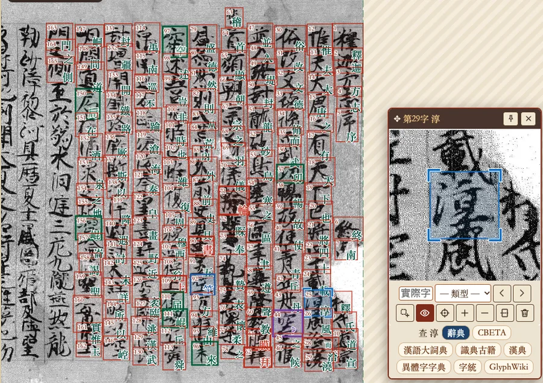
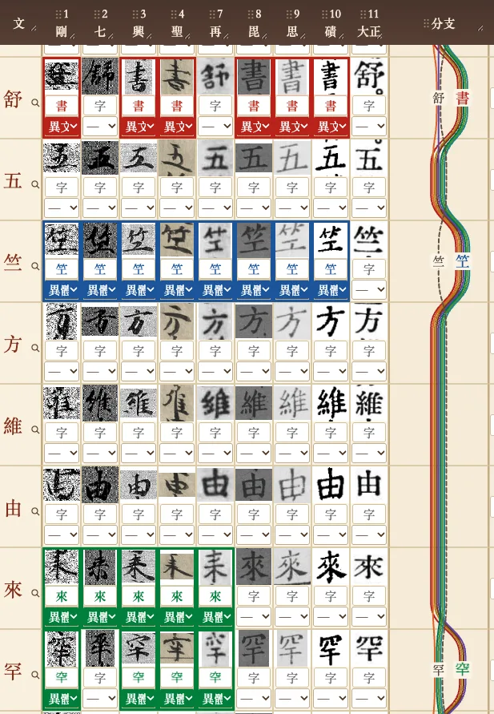
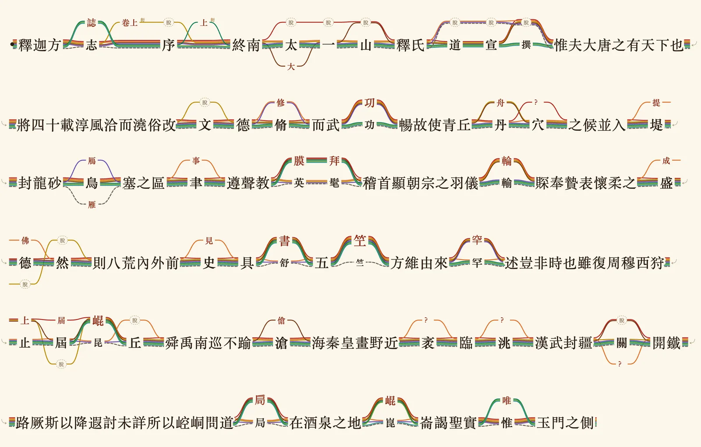

# 對勘室｜CollateDesk

**字級書影對勘工作臺** — *Character-Level Textual Collation with Source Images*

對勘室把多個版本（寫本、刻本、校注本）的書頁影像，依底本正文逐字對齊，讓研究者在同一列上直接比較每個字的字形，並把判斷寫成對照表與校勘記。

## 做出來是這樣

以《釋迦方志》序為例：

| 逐字切框 | 對照表 |
|---|---|
|  |  |

**分支圖**：各版相同處合成一股，異文處分岔。

截圖僅供說明功能；書影各屬原收藏機構。

## 為什麼看影像

對勘室看的是影像，不是轉錄後的文字。每一個字框就是一張單字切圖：異體、補刻、刻工換手，這些在編碼裡消失的訊息，都留在圖上。工具只負責把形放到眼前；異文、異體、要不要出校，判斷留給讀的人。

## 主要功能

| 功能 | 說明 |
|---|---|
| 書影切字 | 古典影像處理（Otsu 二值化、投影）自動切出區塊、行、字框，可逐框修正；不使用機器學習模型 |
| 字序對齊 | 依閱讀順序（直書右→左、行內上→下）與錨點，把每個字框對到底本第幾字 |
| 逐字標注 | 異文、異體字、異體詞、訛字、脫字、衍字、不確定，以及自訂類型 |
| 對照表與校勘記 | 底本逐字為列、各版為欄；校勘記依併用順序自動起草，可逐條修改 |
| 異文分支圖 | 各版相同處合成一股、異文處分岔；可逐字動畫展開，下載 SVG／PNG |
| 匯出 | Word、PDF、校勘記文字檔 |
| 版本屬性 | 全名、類型、系統、年代、出土地、館藏地、編號、筆記；可由 CSV 匯入 |
| 備份 | 所有專案存成一個備份檔，可在其他電腦還原 |

## 資料在哪裡

所有專案、書影與校勘都只存在使用者自己的瀏覽器裡，不會上傳到任何伺服器。請定期按專案列的「備份全部專案」。對勘功能可離線使用；查詢網站按鈕需要連網。

## 建議環境

桌上型或筆記型電腦，Chrome 或 Edge，畫面寬度 1280px 以上。Safari、Firefox 可以使用，但不支援「自動存到電腦檔案」，且 Safari 可能在網站 7 天未使用後清除資料。

## 引用

| 格式 | 寫法 |
|---|---|
| 中文 | 邱琬淳，《對勘室｜CollateDesk：字級書影對勘工作臺》，版本 0.9.0（2026），https://github.com/wanchunchiu/CollateDesk。 |
| English | Chiu, Wan-chun. 2026. CollateDesk (對勘室 Duikanshi): Character-Level Textual Collation with Source Images. Version 0.9.0. https://github.com/wanchunchiu/CollateDesk. |

BibTeX 與機器可讀的引用資訊見 repo 根目錄的 `CITATION.cff`。

## 作者

邱琬淳（Wan-chun Chiu）｜GitHub：https://github.com/wanchunchiu

## 開始使用

網址：https://wanchunchiu.github.io/CollateDesk/ （用 Chrome 或 Edge 開啟）

從建立專案到匯出成果，依序做下面十步。程式內的「📘 操作步驟」是同一份內容；想看各功能在畫面上的位置，按畫面右上角「導覽」。

| 步驟 | 做什麼 | 在哪裡 |
|---|---|---|
| 1. 建立專案 | 一個文本、一段一個專案；名稱可用「書名・卷・段」 | 上方「專案」→「＋ 新專案」 |
| 2. 貼上校定本文 | 把底本（例如《大正藏》）正文貼進來；標點不影響對齊，校完可改成最後採用的文字 | 「校定本文（底本）」 |
| 3. 設定版本 | 填各版本的全名、類型、年代、館藏地，或從 CSV 一次匯入；缺的版本另外新增 | 「版本屬性」、「＋ 新增版本」 |
| 4. 貼上書影 | 點版本分頁，Ctrl＋V 貼上該版書頁圖（也可拖放、選檔）；一個版本可有多頁 | 版本分頁、虛線貼圖區 |
| 5. 切字 | 依序找出正文區塊、行、字框；不準的框再手動修 | 側欄「版面切分」→「一鍵 1→2→3」；「字框工具」 |
| 6. 對齊字序 | 選本段第一字的框設為起點；中間錯位時指定「此框＝第 N 字」（錨點） | 選取框後的「設為段落起點」 |
| 7. 逐字標注 | 填「實際字」，選類型：異文、異體字、訛字、脫字、衍字、不確定、自訂 | 點字框開啟放大鏡 |
| 8. 產生對照表 | 底本逐字為列、各版為欄；在「校勘記」欄修改草稿 | 專案列右邊「對照表」 |
| 9. 匯出成果 | Word、PDF、校勘記；分支圖可下載 SVG／PNG | 對照表「匯出 ▾」「校勘記 ▾」「分支圖」 |
| 10. 保住資料 | 資料只存在這個瀏覽器；定期完整備份，換電腦時用「匯入專案」還原 | 專案列「備份全部專案」 |

## 常見問題

| 問題 | 說明 |
|---|---|
| 換電腦、換瀏覽器後專案不見了 | 資料存在原本那個瀏覽器裡。在舊環境按「備份全部專案」，到新環境「匯入專案」選備份檔即可 |
| 匯入專案會不會蓋掉現在的專案？ | 不會。匯入一律另開新專案 |
| 「自動存到電腦檔案」按鈕不見了 | 這個功能只有 Chrome、Edge 支援；其他瀏覽器請用匯出／備份 |
| Safari 上資料不見了 | Safari 可能在網站 7 天未使用後清除資料，建議改用 Chrome、Edge，並定期備份 |
